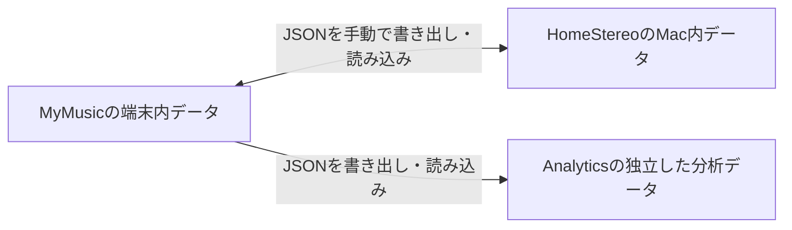

# 評価の受け渡しとGood 8〜15の実機確認

更新: 2026-10-16。

## 今の疎結合の仕組み

MyMusicとHomeStereoは別Git・別アプリ・別の保存領域を持つ。MyMusicはiPhone内のJSON等、HomeStereoはMac内のSQLite等を正本とし、相手のDBや設定へ直接書き込まない。必要なデータだけをversion付きJSONへ書き出し、ユーザーが相手アプリで読み込む。



- Library、Preferences、Playback Events、Playlistsは別文書。評価を渡しても再生履歴やPlaylistは同期しない。
- 同一曲の交換用IdentityはMyMusicのTrack ID。HomeStereoは自身のTrack IDを保持し、MyMusic IDとの対応表を持つ。初期照合には共通root以下の相対path、size、duration、fingerprint等を使う。曲名だけで常に一致するわけではない。
- iCloud Drive等はJSONファイルの運搬手段。置くだけでアプリ内の評価が自動同期される機能はない。
- Preferences schema v2は曲ごとの現在の整数評価とfavorite Boolを渡す。タップ履歴／差分回数ではなく、両端末で押した回数は加算しない。
- MyMusicは保存された評価をExportする。HomeStereoはMacでFavorite／評価を変更した、MyMusic ID接続済みの曲だけを差分Exportする。
- Importに含まれる曲は受信値へ更新し、含まれない曲を削除・初期化しない。同じ曲を両側で編集した場合、自動競合解決はなく、後のImport等で上書きされ得る。
- HomeStereoはExportファイル保存成功時に、Previewと同じ変更世代だけを送信済みにする。相手のImport成功を検知する受領確認は未実装。再送のためJSONを反映確認まで残す。
- Analyticsは独立した分析用データ。Local/Desktop版は評価編集・JSON Exportもできるが、自動的にMyMusic／HomeStereoへ反映はしない。

共通の意味とversion付きデータ形式を揃え、UI・再生・DBを独立して変更できるのが現在の疎結合。仕様の正本は[共通データ交換・保全契約](DataInterchangeContract.md)、未実装事項は[保全課題](DataInterchangeIssues.md)。

## 「再生傾向」と今回の差分Previewの対象

画面の「再生傾向」はPreferences JSONのこと。ハートだけではなく、次の2項目を曲ごとに扱う。

| 項目 | 内容 | Previewでの確認例 |
| --- | --- | --- |
| 再生傾向の評価値（playbackPreference） | Good／Badで変える-10〜15の整数 | 15 → 14、0 → -1 |
| ハート（favorite） | お気に入りのON／OFF | OFF → ON、ON → OFF |

「再生傾向」という名前でも、再生回数・再生時間・完走／Skipの履歴全体をこのJSONで送るわけではない。Good／Badの値を変更した場合も、ハートを変更した場合も、Preview後の再編集チェックの対象になる。

| その他のデータ | 受け渡し・適用の単位 | 今回追加した評価／ハート差分Previewとの関係 |
| --- | --- | --- |
| Library | 曲情報・Track IDの照合用snapshot | 別JSON。今回の差分表示の対象外 |
| Playback Events | 日時・実聴時間・完走／Skip等のイベント | 別JSON。既存のイベント読込Previewで確認し、評価値の置換とは区別する |
| Playlists | Playlist ID・名前・タグ・曲順 | 別JSON。既存の更新確認／Previewを使用。今回の評価・ハートと同じ差分UIを追加したわけではない |
| 特徴量・音量解析・EQ・ジャンルプリセット等 | 各データ固有の形式と対応画面 | 今回のPreferences Previewとは別。全種類に差分Previewが実装されたわけではない |

以下の試験は評価だけ／ハートだけ／両方をそれぞれ試す。再生履歴やPlaylist等の保全は、意図せず変わっていないことも確認する。

## 今回の評価と演出

| 項目 | MyMusic | HomeStereo |
| --- | --- | --- |
| 保存・編集・交換範囲 | -10〜15 | -10〜15 |
| 選曲効果 | +10は21、+11〜+15は25/29/33/37/42（2026-10-27 Beta） | +10は21、+11〜+15は25/29/33/37/42（2026-10-27 Beta） |
| Good 8〜15の豪華な演出 | 対応 | 対象外 |
| 評価順や評価別表示 | 生の値を使用 | 生の値を使用 |

Goodの選曲weightは+15まで段階的に増加する。15からBadを押すと14となり、weightは42から37へ下がる。旧版受信側は11以上を拒否するため、両側を対応版へ更新してから交換する。

2026-10-16の導入基準: MyMusic `0bcbf8a`、HomeStereo `94454a9`（差分Preview対応、正式配置build `20261016214812`）。VesperaへのInstall／LaunchとHomeStereo正式配置／起動は確認済み。実機での以下のチェック成功を意味しない。

## 開始前

- [ ] 両アプリのbackupを確保する。全体Restoreの検証はこの評価確認と分け、試験用データで行う。
- [ ] 両方でTrack ID照合済みの通常曲を1曲選び、元の評価・ハート状態・Track IDを控える。比較用に変更しない曲も1曲決める。
- [ ] Macに未送信の評価変更がある場合、先にJSON保存・整理する。同じ曲を両側で変更していたら採用値を決め、基準を揃えてから開始する。MyMusicの全件Preferencesを安易に読み込んでMac側編集を消さない。
- [ ] 試験中は片側ずつ編集する。新旧JSONを区別できるファイル名を付ける。

## 1. MyMusicの演出と保存

1. 通常再生画面で試験曲をGood 8にし、8→9→10→11→12→13→14→15と1回ずつ増やす。
2. 数字が1ずつ増え、星の数・大きさ・広がり・光量が段階的に増すことを確認する。8〜9は金／白、10から周回する輪、11から虹色が加わる。
3. タップ時の波紋・アイコン拡大も強まることを確認する。15でもう一度押して16にならないことを確認する。
4. Badで15→14→…→8と戻し、演出も小さくなることを確認する。
5. 小型プレイヤー、ハイライト、Visual Worldでも確認する。Visual Worldは周囲の星・光が対象で、共通ボタンのタップ波紋は対象外。
6. 数字・隣の操作が読める／押せること、はみ出した装飾がタップを奪わないことを確認する。
7. 別曲へ移った時に評価・演出が切り替わり、再起動しても15を保持することを確認する。
8. iOSの「視差効果を減らす」有効時に連続する動きが止まることを確認する。backgroundからの復帰でも正常に再表示することを確認する。
9. 数分再生して音切れ、操作の引っかかり、目立つ発熱がないことを確認する。

5〜7は従来の3つの光。8〜15は星7〜21個、外側への広がり6〜20pt。動きと明るさで見え方は変わるため、静止画だけで最終判断しない。

## 2. MyMusic → HomeStereo

1. 試験曲を15にする。
2. MyMusicの設定・データ管理内で「再生傾向を書き出す」を選び、`MyMusic-Playback-Preferences.json`をMacへ渡す。
3. HomeStereo「MyMusic連携」のPreferences読み込みで選択する。評価・ハートの「現在→読み込み後」、更新予定／変更なし／未照合の件数を確認して「読み込む」。変更なしはtoggleで表示する。
4. 未解決なら「MyMusic適用状況」でID対応を確認し、必要ならMyMusicのLibrary JSONを読み込んで照合する。曲名の似た別曲へ適用して続行しない。
5. 評価15とハートが一致し、10へ丸められないことを確認する。比較用の未変更曲も確認する。
6. HomeStereoの分析・評価別一覧で15が表示されることを確認する。11でも同じ流れを試し、「評価11」と「未設定」が混ざらないことを確認する。

HomeStereoに豪華な星・虹色がないのは仕様。

## 3. HomeStereo → MyMusic → 再送

1. HomeStereoで試験曲を15→14へ変更する。
2. 「MyMusic連携」からPreferences書き出しを選び、変更曲Previewに試験曲が含まれることを確認して保存する。
3. JSONをiPhoneへ渡し、MyMusicの「再生傾向を読み込む」で選択する。差分sheetで評価・ハートの「現在→読み込み後」と件数を確認し、「確認して読み込む」。キャンセルでは変更されない。
4. 評価14と14相当の演出、ハートが反映されることを確認する。
5. MyMusicから再ExportしてHomeStereoへImportし、14を維持することを確認する。
6. 同じJSONを再Importしても数値の加算・曲の複製がないことを確認する。
7. 両アプリを再起動し、評価・ハート・比較用の未変更曲が保たれることを確認する。
8. 必要なら控えた元の評価・ハートへ戻し、片側で修正して相手へ渡す。古い全件JSONの再Importで、その後の別曲編集まで戻さない。

HomeStereoで一度Exportした曲は、そのまま再Exportしても対象外になり得る。反映確認までは保存したJSONを保持し、再送には同じファイルを使う。

## 差分Preview：キャンセルと再編集の具体的な確認

### 準備する3パターン

1曲ずつ、または同じ曲で値を変えて順番に試す。受信後の値が現在と異なる条件を作り、元の値を控える。

| パターン | 評価の例 | ハートの例 |
| --- | --- | --- |
| 評価だけ変更 | 10 → 15 | OFF → OFF |
| ハートだけ変更 | 10 → 10 | OFF → ON |
| 両方変更 | 10 → 15 | OFF → ON |

### A. MyMusic → HomeStereo：キャンセル

1. MyMusicから試験用Preferences JSONを書き出す。
2. HomeStereoで読み込みPreviewを開き、試験曲の現在値と受信後の値を上表に沿って確認する。変更なしtoggleも切り替える。
3. 「キャンセル」を押す。
4. HomeStereoの曲一覧／再生バーで評価・ハートの両方が元のままか確認する。Macの未送信変更も消えていないことを確認する。

### B. HomeStereo：Previewを開いたまま同じ曲を再編集

1. 同じJSONを再選択し、読み込みPreviewを開く。試験曲を現在の再生曲にしておくとメニューバーから編集しやすい。
2. **Previewを閉じずに**メニューバー等から試験曲のGood／Badを1回操作する。
3. Previewの「読み込む」を押す。確認後に状態が変わった旨のエラーになり、読み込みが拒否されることを確認する。
4. 2で編集した評価が残り、ハートも受信値へ勝手に変わっていないことを確認する。Macの未送信変更も維持されることを確認する。
5. JSONを選び直して新しいPreviewを開き、今の評価が「現在」欄へ反映されることを確認してから適用する。
6. 同じ流れを**ハートだけの再編集**でも実施する。Good／Badだけでなく、ハート変更も拒否条件になることを確認する。

キャンセルしてから編集・再選択した場合は、新しい状態でPreviewを作り直す正常系であり、「Preview中の再編集」試験にはならない。

### C. HomeStereo → MyMusic：キャンセルしてから適用

1. HomeStereoで試験曲を15→14へ変更し、Preferencesを書き出す。ハートだけ／両方の変更パターンも別途試す。
2. MyMusicの「再生傾向を読み込む」で選択し、差分sheetに15→14と正しいハート状態が表示されることを確認する。
3. 「キャンセル」を押し、MyMusicの評価・ハートが元のままか確認する。
4. 同じJSONを再選択し、「確認して読み込む」を押す。Previewどおりの評価・ハートになることを確認する。
5. 同じJSONを再選択すると「変更なし」になることを確認し、再起動後も値が残ることを確認する。

Macから保存したJSONはiPhoneでの反映を確認するまで保持する。Macで再Exportして空になっても、最初のファイルは再送に使える。

### D. MyMusic：Previewを開いたまま再編集（Watch等が使える場合）

1. MyMusicでPreferencesの差分sheetを開き、試験曲を再生中にする。
2. **sheetを閉じずに**Watch等から同じ曲のGood／Badを操作し、iPhoneの実際の評価状態が変わったことを確認する。sheetの「現在」表示は確認開始時のsnapshotのため自動更新されない。
3. 「確認して読み込む」を押し、再確認を求めるエラーになって、Watch等で変更した値が残ることを確認する。
4. キャンセルしてJSONを選び直し、最新の現在値で差分を確認できることを確認する。
5. ハートだけの再編集でも同様に確認する。送った操作がiPhoneへ届かなかった場合は、再編集拒否の試験成功とはしない。

Watch等の別操作経路がなければDは未実施として残す。sheetを閉じて編集しただけではDの代わりにならない。保存処理中の操作は抑止されるため、再編集は確認ボタンを押す前に行う。

### 共通の合格条件

- [ ] JSON選択だけ／キャンセルでは評価・ハートが変わらない。
- [ ] 評価だけ・ハートだけ・両方の差分と変更なしが正しい。
- [ ] 未照合の現在値を0と表示せず、適用しない。
- [ ] Preview後の対象曲の再編集は拒否し、編集済みの値を保持する。
- [ ] HomeStereoでは拒否時に未送信情報を解除しない。
- [ ] 比較用の未変更曲・再生履歴・Playlistを意図せず変更しない。
- [ ] 多数の曲でも100件以降の変更を確認できる。

## 4. 選曲効果・旧backupの検証範囲

10と15の頻度が同じかを少数回のshuffleで判定しない。weightの同一性は自動テストで確認済み。実機は15でもqueue生成・再生が正常に動くかを確認する。

自動検証済み: MyMusicの保存／再起動／Watch通信／backup manifest v1・v2復元、HomeStereoの旧DB v14保存状態backup復元→v15移行と既存field／ID／未送信token保持、評価の反復JSON往復、Analyticsの旧DB移行。実ユーザーbackupの復元や実端末間往復は、自動テストから成功扱いにしない。

旧backupを新アプリで読む互換性と、新しい15入りデータを旧アプリで読む互換性は別。後者は保証しない。

## より効率よくするには

### 今の機能だけでできる運用

- iCloud Drive等に交換専用folderを1つ決め、日付・方向をファイル名に含める。例: `2026-10-16-iPhone-to-Mac-preferences.json`。ファイルの同期完了後、相手で手動Importする。
- 評価だけならPreferencesだけを交換する。毎回Library・履歴・Playlistを送り直さない。LibraryはID照合に必要な時に使う。
- 編集は「iPhoneを使う時間→Macへ渡す→Macを使う時間→iPhoneへ戻す」の順でまとめ、同曲の並行編集を避ける。
- 毎回の短い確認は「15でExport→Macで14→iPhoneへ戻す→再起動」の1往復。演出の全8段階、11／未設定、Reduce Motion、狭い画面は初回や表示変更時に行う。
- 一度確認した記録を残し、変えていない部分の全試験を毎回やり直さない。

### 差分Previewの実装状況と今後の改善候補

差分Previewは上記の導入基準revisionに含まれる。2026-10-16 21:49 JSTにVesperaへInstall／Launch、HomeStereoはbuild `20261016214812`として正式配置済み。実機での画面確認・JSON往復は別途実施する。残る案の推奨順は「確認の手間を減らす→受け渡しの手間を減らす」。DBを共通化せずJSON境界を維持できる。

1. **差分PreviewはBeta実装済み**: 更新前→受信後の評価・ハート、変更件数、未解決曲を表示し、Preview後の対象曲の再編集は拒否する。前回の受け渡し状態の記録は未実装。
2. **送信fileの履歴・受領確認**: 保存済みと相手で反映済みを区別し、未受領のJSONと変更世代を再送できるようにする（DI-005／DI-007に関連）。
3. **交換folderを記憶した読込候補の提示**: 毎回file pickerで探す手間を減らし、Preview後の明示適用を維持する。iOSのfolder権限、iCloudの未download／部分書込、旧file再適用の判定が必要。
4. 自動同期はさらに後。安定した変更世代・競合解決・原本保持・受領確認が揃ってから検討する。現状の後勝ちImportをそのまま自動化しない。

「同じfolderを使う」は運用改善、「folder監視で自動適用する」は機能開発であり、現在は後者を実装していない。

## 結果の記録

`sessions/YYYY-MM-DD-<topic>.md`へ次を記録する。チェック欄は実施時だけ埋める。

```text
日時／iPhone・MacのOS／アプリrevision:
試験曲のTrack ID／元の評価・ハート:
演出8〜15／上限15／減少／各画面／Reduce Motion:
MyMusic 15 → HomeStereo 15:
HomeStereo 14 → MyMusic 14:
評価11と未設定／同じJSON再Import／再起動:
キャンセル（両アプリ）／Preview中の評価再編集／ハート再編集:
再編集拒否後の値・未送信情報／未実施の操作経路:
未変更曲・ハートの保全:
使用JSONと保管場所:
不具合・再現手順・未実施項目:
```

全般的な実機確認は[実機検証チェックリスト](DeviceValidationChecklist.md)、今回の自動検証・配置履歴は[評価範囲の作業記録](../sessions/2026-10-16-preference-range.md)と[演出・配置の作業記録](../sessions/2026-10-16-preference-effects-deploy.md)を参照。

2026-10-27 Beta: 両アプリのGood選曲weightを再配分。保存・交換する評価値とschema v2は変更しない。負評価とMyMusicの聴きすぎ補正は維持する。共通データ交換・保全契約revision 6を両Gitで同期。
